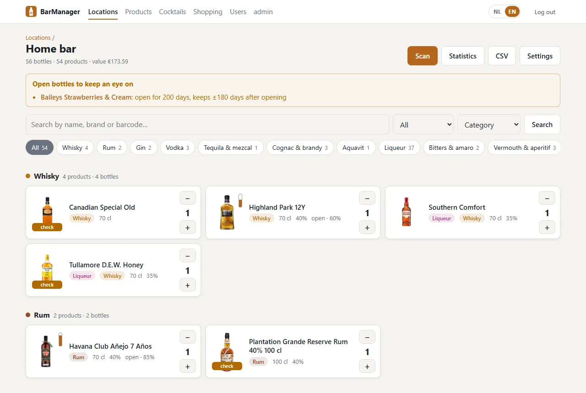
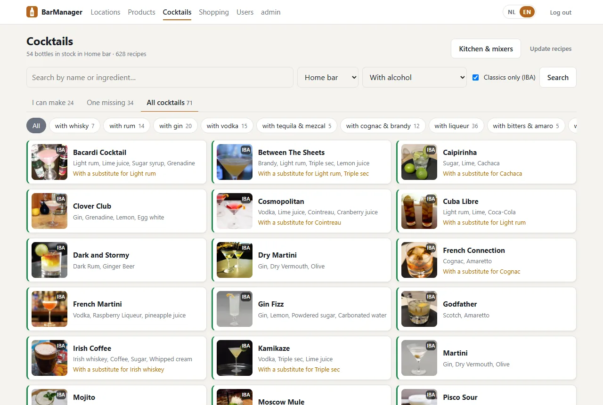
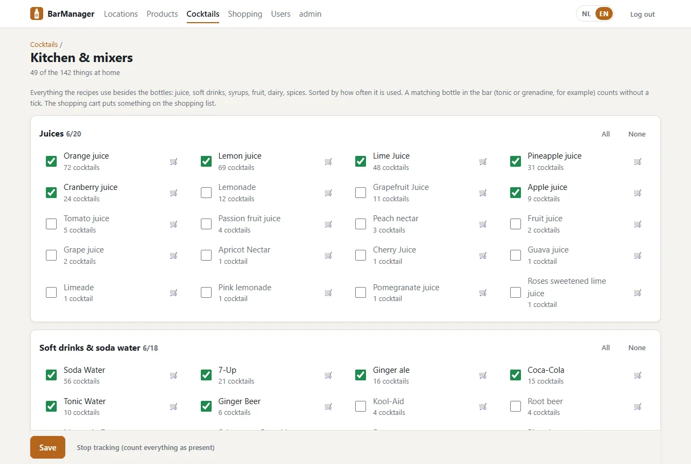
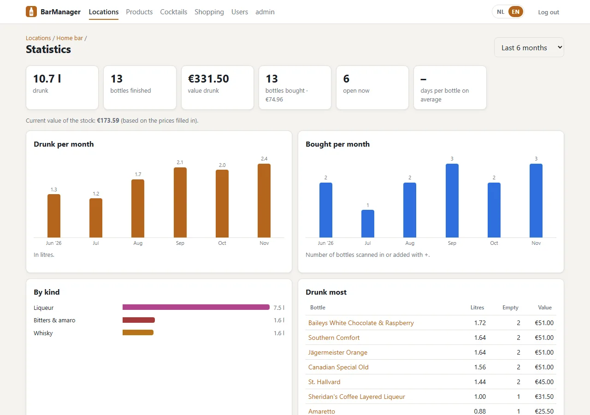
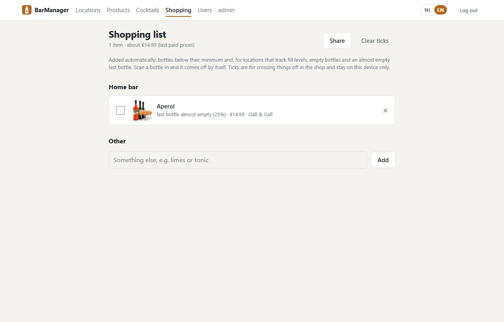

<p align="center">
  
</p>

<h1 align="center">BarManager</h1>

<p align="center">
  <b>Your home bar, always in stock.</b><br>
  Scan your bottles with your phone, see which cocktails you can make tonight and what to buy next.<br>
  Free, open source and self-hosted.
</p>

<p align="center">
  <a href="https://github.com/Lexvdpoel/barmanager/releases/latest"></a>
  <a href="https://github.com/Lexvdpoel/barmanager/actions/workflows/docker-publish.yml"></a>
  <a href="https://github.com/Lexvdpoel/barmanager/pkgs/container/barmanager"></a>
  
  <a href="LICENSE"></a>
  <a href="https://github.com/sponsors/Lexvdpoel"></a>
</p>

<p align="center">
  <a href="https://barmanager.club">Website</a> ·
  <a href="#install">Install</a> ·
  <a href="CHANGELOG.md">Changelog</a> ·
  <a href="https://github.com/Lexvdpoel/barmanager/discussions">Discussions</a> ·
  <a href="https://github.com/sponsors/Lexvdpoel">Sponsor</a>
</p>

<p align="center">
  
</p>

## Why BarManager

A home bar grows one bottle at a time, and after a while nobody knows what is in the cabinet, what is
nearly empty, or what you could mix with it. **BarManager keeps the list for you.** Scan a barcode with
your phone camera and the bottle is in stock: name, brand, photo, alcohol and category are looked up
online. From there it shows which cocktails you can make, warns you when an open bottle is past its
best, and writes the shopping list.

It runs as one Docker container on your own server or a Raspberry Pi, with your data in a single
folder. No account, no cloud, no tracking. The app is in **English and Dutch** (the NL / EN switch at
the top; the default follows your browser).

## Highlights

<table>
  <tr>
    <td width="50%" valign="top">
      
      <b>Cocktails</b><br>
      More than 600 recipes from TheCocktailDB, matched against your bottles: what you can make, what is
      one ingredient away, and which bottle would unlock the most new drinks. It knows that Cointreau is
      a triple sec and a Highland Park is a Scotch, and marks substitutes.
    </td>
    <td width="50%" valign="top">
      
      <b>Kitchen &amp; mixers</b><br>
      Tick the juices, sodas, syrups, fruit and spices you have once; every recipe then shows exactly
      what you are missing, and the missing ones go to the shopping list in one tap.
    </td>
  </tr>
  <tr>
    <td width="50%" valign="top">
      
      <b>Open bottles &amp; statistics</b><br>
      Mark a bottle full, ¾, ½, ¼ or empty. Cream liqueurs, vermouth and wine get a warning before they
      turn, and you get litres per month, what goes fastest, how long a bottle lasts and what it was worth.
    </td>
    <td width="50%" valign="top">
      
      <b>Shopping list</b><br>
      Bottles below their minimum, empty ones and an almost empty last bottle land on the list by
      themselves, with the price and shop of last time. Scanning a new bottle takes it off again.
    </td>
  </tr>
</table>

And also:

- **Scanning** with the phone camera (built-in `BarcodeDetector`, or [ZXing](https://github.com/zxing-js/library)
  on iPhone and Firefox) or any USB / Bluetooth hand scanner. The scanner pauses after each bottle, so
  nothing is counted twice, and beeps so you hear it worked.
- **Automatic lookup** in Open Food Facts, UPCitemdb, Wikipedia and optionally the web (SearXNG or
  Brave Search), with product photos and **over twenty categories**; a bottle can be in two at once
  (a honey whiskey is whisky *and* liqueur).
- **Local AI, optional**: a small model in [Ollama](https://ollama.com) (it runs on a Raspberry Pi 5)
  fills in brand, country, description and alcohol, only from the sources it found. It never guesses
  numbers and never invents a product for an unknown barcode.
- **Locations and people**: home bar, cellar, clubhouse, each with its own stock; give others access per
  location. Administrators manage users.
- **Value**: price, purchase date and shop per bottle, the value of each location, and a CSV export.
- **Bar menu for guests**: a public page with a QR code that shows what is in the bar and which cocktails
  you can make, without quantities or prices.

```
phone / browser ──https──► reverse proxy ──► BarManager (FastAPI + SQLite, /config)
                                                 │ unknown barcode
                                                 ▼
          Open Food Facts · UPCitemdb · Wikipedia · SearXNG / Brave (optional) · Ollama (optional)
```

## Install

The image `ghcr.io/lexvdpoel/barmanager` is built for **amd64 and arm64** (so also for a Raspberry Pi).
Every push to `main` is tested and published as `latest`; releases also get a version tag.

```yaml
# docker-compose.yml
services:
  barmanager:
    image: ghcr.io/lexvdpoel/barmanager:latest
    environment:
      - TZ=Europe/Amsterdam
      - BM_ADMIN_USERNAME=admin
      - BM_ADMIN_PASSWORD=change-me
    volumes:
      - ./appdata/barmanager:/config
    ports:
      - "8080:8080"
    restart: unless-stopped
```

or

```bash
docker run -d --name barmanager -p 8080:8080 \
  -e BM_ADMIN_PASSWORD=change-me \
  -v /path/to/appdata/barmanager:/config \
  --restart unless-stopped ghcr.io/lexvdpoel/barmanager:latest
```

On the first start the administrator `admin` is created; without `BM_ADMIN_PASSWORD` the generated
password is in the container log. **Put a reverse proxy with HTTPS in front of it** (for example Nginx
Proxy Manager or Caddy): browsers only allow the camera on secure pages. A hand scanner works anyway, it
"types" the barcode into the text field.

`/config` holds `barmanager.db` (SQLite) and `images/`. Keep the database on local storage rather than
a network or cluster file system.

### Settings (environment variables)

| Variable | Default | |
|---|---|---|
| `BM_ADMIN_USERNAME` / `BM_ADMIN_PASSWORD` | `admin` / generated | First administrator, only used when the database is empty |
| `BM_SEARXNG_URL` | empty | Your own [SearXNG](https://docs.searxng.org) (with `json` in `search.formats`), e.g. `http://searxng:8080`: web search for barcodes, photos and sources for the AI |
| `BM_BRAVE_API_KEY` | empty | [Brave Search API](https://brave.com/search/api/) key, an alternative to SearXNG |
| `BM_OLLAMA_URL` | empty | Ollama server for the AI, e.g. `http://ollama:11434` |
| `BM_OLLAMA_MODEL` | `qwen3:4b` | The model Ollama uses (downloaded on first use, ±2.5 GB) |
| `BM_OLLAMA_TIMEOUT` | `600` | Maximum time per AI answer (seconds) |
| `BM_UPCITEMDB` | `true` | Use UPCitemdb (±100 lookups per day without a key) |
| `BM_MAX_IMAGES` | `3` | How many photos are fetched per product automatically |
| `BM_LOOKUP_TIMEOUT` | `8` | Time-out per lookup request (seconds) |
| `BM_SESSION_DAYS` | `30` | How long you stay logged in |
| `BM_PORT` | `8080` | Port inside the container |
| `PUID` / `PGID` | `99` / `100` | User the app runs as (owner of `/config`) |
| `TZ` | `Europe/Amsterdam` | Time zone |

### Optional: local AI and web search

```yaml
  ollama:
    image: ollama/ollama:latest
    volumes:
      - ./appdata/ollama:/root/.ollama
    restart: unless-stopped
  searxng:
    image: searxng/searxng:latest
    volumes:
      - ./appdata/searxng:/etc/searxng   # settings.yml with "json" in search.formats
    restart: unless-stopped
```

and on BarManager `BM_OLLAMA_URL=http://ollama:11434` and `BM_SEARXNG_URL=http://searxng:8080`. On a
Raspberry Pi 5 the AI takes about a minute per bottle, in the background; give Ollama a low CPU priority
(`--cpu-shares=64`) if other services share the machine.

## Data sources

| Source | Key | What for |
|---|---|---|
| [Open Food Facts](https://world.openfoodfacts.org) | no | Most drinks from European shops: name, brand, category, volume, alcohol, photo (ODbL) |
| [UPCitemdb](https://www.upcitemdb.com) | no | International products |
| [Wikipedia](https://www.wikipedia.org) | no | The kind of drink, and sources for the AI |
| [TheCocktailDB](https://www.thecocktaildb.com) | no | The cocktail recipes and photos, refreshed weekly |
| SearXNG / Brave Search | optional | Barcodes the databases do not know, product photos, sources for the AI |

## Develop

You need Python 3.11 or newer.

```bash
git clone https://github.com/Lexvdpoel/barmanager.git
cd barmanager
python -m venv .venv
.venv/bin/pip install -e ".[dev]"             # Windows: .venv\Scripts\pip
.venv/bin/python -m pytest -q
BM_ADMIN_PASSWORD=test1234 .venv/bin/barmanager   # http://localhost:8080
```

| Path | What |
|---|---|
| `barmanager/web.py`, `pages.py` | Pages: locations, stock, products, cocktails, shopping list, statistics, bar menu |
| `barmanager/api.py` | JSON for the scan page and the +/− buttons |
| `barmanager/lookup.py` | Looking up barcodes and photos |
| `barmanager/ai.py` | Grounded AI enrichment through Ollama |
| `barmanager/cocktails.py` | Recipes, matching bottles to ingredients, kitchen & mixers |
| `barmanager/categories.py` | Automatic categories |
| `barmanager/i18n.py`, `locale_en.py` | Dutch and English: every text goes through `_()` |
| `barmanager/static/scan.js` | The camera scanner |
| `site/` | The website [barmanager.club](https://barmanager.club) (Cloudflare Worker) |

See [CONTRIBUTING.md](CONTRIBUTING.md) before you open a pull request.

## Community

- **Questions** go to the [Q&A in Discussions](https://github.com/Lexvdpoel/barmanager/discussions/categories/q-a).
- **Ideas** go to [Ideas](https://github.com/Lexvdpoel/barmanager/discussions/categories/ideas); upvote the ones you want.
- **Bugs**: open a [bug report](https://github.com/Lexvdpoel/barmanager/issues/new/choose).
- **Security problems**: report them privately, see [SECURITY.md](SECURITY.md).

Everyone who takes part follows the [Code of Conduct](CODE_OF_CONDUCT.md).

## License

[MIT](LICENSE). Made by [HOLLANDPOEL](https://hollandpoel.com). Recipes and cocktail photos come from
TheCocktailDB, product data from Open Food Facts (ODbL), UPCitemdb and Wikipedia.

Please drink responsibly.
